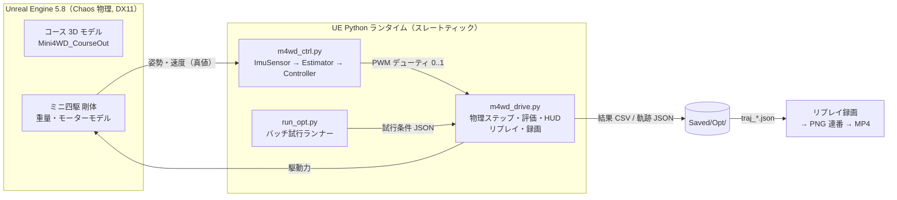

# ミニ四駆 ラップタイム最適化レポート（UE シミュレーション）

- 対象: 1/32 マッドレイザー（MAシャーシ）＋ マッハダッシュモーターPRO
- コース: タミヤ オーバルホームサーキット 立体レーンチェンジタイプ（UE 上の 3D スキャン再構築モデル）
- 走行動画: `UE走行動画_ラップタイム最適化_3周完走.mp4`（前半は実時間 ×1.0、後半はスロー ×0.5）
- 作成日: 2026-10-28

---

## 1. 結論

| 項目 | ベースライン（無制御・最高速度 3.0 m/s） | **最適化後（IMU速度制御）** |
|---|---|---|
| 3周合計タイム | 5.47〜5.53 s | **4.049 s**（動画の走行）／15試行平均 **4.030 s** |
| 完走率（初期位置・姿勢を揺らした試行） | 3.0 m/s を超えるとコースアウト | **15/15** |
| 改善幅 | – | **約 −1.45 s（−26 %）** |

ラップごとの内訳（動画の走行 FC_p0）は 1周目 1.753 s、2周目 0.893 s、3周目 1.402 s です。15試行の平均は 1.75 / 0.89 / 1.39 s でした。
1周目と3周目はレーンチェンジで橋の上を通る周回で、手前で減速が要るぶん遅くなります。2周目は橋の下を通る周回で、全開のまま走り抜けられます。

**これ以上縮められないと判断した理由**

- 橋に入る速度（上り坂の手前での速度）が安全に通れる範囲は、おおよそ 2.6〜2.85 m/s しかありません。この範囲を外すと、上側では橋から飛び出し、下側では壁に着地します。
- 最後の調整（3周目に向けた減速開始点を遅らせる `a_coast_late` 5.0→5.25）で縮んだのは約 0.01 s だけでした。しかもその設定では再実行時にコースアウトが出ました（11試行中10完走）。5.5 にすると 9試行中8完走に落ちます。
- 重量と最高速度はどちらも制約の上限・下限に張り付いています（下表）。これ以上タイムを削るには、橋への進入速度の窓を広げるしかなく、制御側の余地はほぼ残っていません。

---

## 2. 各パラメータの値

### 2.1 最適化したパラメータ（車体）

| パラメータ | 値 | 範囲・根拠 |
|---|---|---|
| 車体重量（センサ・電池・モーター込み） | **90 g** | タミヤ公式レギュレーション「全装備最低重量 90 g（電池・モーター含む）」の下限。軽いほど加速が上がるため下限に張り付く |
| 最高速度 VMAX | **8.8 m/s** | マッハダッシュPRO 約 24,500 rpm、ギヤ比 3.5:1、タイヤ径 24 mm から求めた上限。これより上はモーターとギヤの組み合わせで実現できない |
| 最大駆動力 F0 | **1.302 N**（従属値） | F0 = MOTOR_K / VMAX。ギヤ比で最高速度と駆動力を交換する関係 |

最高速度は上限の 8.8 m/s を使い、カーブや橋の手前では IMU 制御で速度を落とします。最高速度を下げて安全側に振る（例: 3.0 m/s）よりも、直線とカーブを高速で走れる分だけ速くなります。

### 2.2 制御パラメータ（`ue/m4wd_ctrl.py` の `DEFAULT_CTRL`、最終設定 vC）

| 名前 | 値 | 意味 |
|---|---|---|
| `v_over` | 2.7 m/s | 橋に上がる坂の手前での目標速度 |
| `v_bridge` | 2.8 m/s | 橋の上で保持する速度 |
| `kp_bridge` | 8.0 | 橋の上の速度ループの比例ゲイン |
| `a_coast` | 4.5 m/s² | 1回目の橋（1周目）の減速開始点を決めるときの想定減速度 |
| `a_coast_late` | 5.0 m/s² | 2回目以降の橋（3周目）用の想定減速度。進入速度が高いので別にした |
| `r_eff` | 0.37 m | 方位角を距離に変換する実効カーブ半径 |
| `l_str` | 0.93 m | 直線区間（2本）の長さ |
| `phi_post` | 35° | レーンチェンジ後、全開に戻すまでの方位角 |
| `kp` | 4.0 | 通常区間の速度ループの比例ゲイン |
| `v_under` | 99（制限なし） | 橋の下を通る周回の速度制限 |
| `first_over` | 1 | スタート直後の1回目のレーンチェンジで橋の上を通る（内側レーンからのスタート） |
| `emu_from` | −1（無効） | 仮想モーター則（試したが不採用） |

### 2.3 固定した物理モデル定数（地球上の条件）

| 定数 | 値 |
|---|---|
| 重力加速度 g | 9.80665 m/s² |
| タイヤ摩擦係数 μ | 1.0（駆動加速度の上限は μg ≈ 9.8 m/s²） |
| モーター定数 MOTOR_K = F0·VMAX | 13.0 × 0.1259 × 7.0 ≈ 11.46 N·m/s |
| 惰性走行時の減速 ROLL_DECEL | 0.25 × v [m/s²] |
| 駆動回路 | ローサイド PWM スイッチ 1 個（実機の `control_motor.ino` と同じ。ブレーキなし、逆転なし） |

駆動力のモデルは F = F0 · max(0, duty − v/VMAX)、加速度は a = min(F/m, μg) です。

### 2.4 IMU（仮想センサ）

| 項目 | 値 |
|---|---|
| 想定デバイス | LSM6DS3 相当の 6 軸 IMU（実機の `get_imu.ino` と同じ構成） |
| サンプリング | 200 Hz（各サンプルは 5 ms 区間の平均） |
| レンジと分解能 | ±16 g／±2000 dps、0.001 g／0.1 dps に量子化 |
| 軸 | x 前方、y 左、z 上 |

---

## 3. 制御手法

制御に使う入力は IMU の加速度とジャイロの値だけです。位置センサやコースの通過マーカーは使っていません。

### 3.1 推定器（ストラップダウン航法）

1. **姿勢**: ジャイロの角速度を積分して回転行列を更新し、毎ステップ正規直交化します。
2. **方位角 ψ**: 回転行列からヨー角を取り出し、±180° の折り返しを展開した連続値として持ちます。右回りに走るので ψ は単調に減ります。
3. **速度 v̂**: 加速度（比力）を航法座標系に変換して重力を足し、ベクトルとして積分します。v̂ はその大きさです。坂や橋の上で車体が傾いても、速度の推定がずれにくくなります。

### 3.2 方位角だけでコース上の位置を求める

このコースは 1 周で ψ が −360° 進みます。n 回目のレーンチェンジ（S 字）は ψ ≈ −180° − 360°·n の位置にあります。
レーンチェンジのたびに内側と外側のレーンが入れ替わるので、内側スタートなら 0, 2, 4… 回目が**橋の上**、1, 3… 回目が**橋の下**になります。
「レーンチェンジまでに残っている方位角」rem = ψ − (−180 − 360n) が、そのまま「橋までの残り距離」の手がかりになります。

### 3.3 速度指令の決め方（区間ごと）

| 区間 | 速度指令 v_t |
|---|---|
| 橋の上を通る周回で、橋に入る前 | 減速開始点の計画: v_lim = √(v_over² + 2·a_coast·s_go) |
| 橋の上（rem ≤ 0 から、レーンチェンジ後 `phi_post` まで） | v_bridge = 2.8 m/s を `kp_bridge` で保持 |
| 橋の下を通る周回、その他の区間 | 全開（duty 100 %） |

**残り距離 s_go の求め方**

- カーブ区間: 残りの方位角 × `r_eff` で距離に換算します。
- 直線区間（方位角が変わらない）: 推定速度を積分して進んだ距離を測ります（オドメトリ）。1周目はスタートラインが直線の中央にあるので、`l_str/2` から数え始めます。

ブレーキがないので、減速は惰性走行（duty 0）だけでしかできません。そのため「この距離を惰性で走れば v_over まで落ちる」地点を逆算し、そこで指令を下げ始めます。3周目は進入速度が高いので、想定減速度を別の値 `a_coast_late` にしました。

### 3.4 デューティの計算

    d = v_t / VMAX + kp · (v_t − v̂) / VMAX    （0〜1 にクリップ）

右辺の第1項は目標速度に対応するフィードフォワード、第2項は比例フィードバックです。d は IMU サンプルごと（200 Hz）に更新し、次のサンプルまで同じ値を保持します。

### 3.5 試して採用しなかった方式

| 方式 | 結果 |
|---|---|
| 制御なし（最高速度を下げるだけ） | 3.0 m/s で 5.47 s。3.25 m/s 以上では橋でコースアウト |
| 方位角ゾーンで減速（固定角度で減速開始） | 4.25〜4.37 s。周回ごとに進入速度がばらつく |
| 高ゲインの追従制御（kp 15） | 12/12 でコースアウト |
| 仮想モーター則（低ギヤのモーター特性を真似る、`emu_from`） | 3周目にコースアウト（12試行中3完走） |
| 減速度を大きく見込む（a_coast 6） | 最速 3.87 s が出たが、12試行中3完走で不採用 |

---

## 4. システム構成

### 4.1 構成要素

| ファイル | 役割 |
|---|---|
| `3dsim/mini4wd_course/ue/m4wd_ctrl.py` | 純 Python（unreal に依存しない）の仮想 IMU、推定器、制御器 |
| `3dsim/mini4wd_course/ue/m4wd_drive.py` | 車両の物理（モーター、摩擦、惰性）、制御器の呼び出し、コースアウト判定、ラップ計測、結果出力、軌跡リプレイ、フレーム録画 |
| `3dsim/mini4wd_course/ue/run_opt.py` | `py run_opt.py <batch.json>` で試行バッチまたはリプレイ録画を実行 |
| `3dsim/mini4wd_course/opt/*.json` | 試行バッチの定義（パラメータと初期位置の揺らぎ） |
| `3dsim/MiniYonkuSim/Saved/Opt/` | 結果 CSV（b01〜b20）、トレース、軌跡 JSON |

### 4.2 評価条件

- 物理ステップは time dilation 0.25 で約 2 ms（約 120 fps 時）。
- 1 試行は静止状態からスタートし、3 周を完走するまでです。
- **頑健性**: スタート位置を横に dy = ±0.05〜0.1 cm、向きを dyaw = ±0.1〜0.2° 揺らした条件も含めて評価しました。合格は全条件での完走です。
- **コースアウト判定**: 車体原点がコース面より下（z < 0.35 cm、床に落ちた状態）、0.5 秒を超える裏返り、またはコースの外接矩形 + 8 cm の外に出たらコースアウトとします。ほかに 12 秒のタイムアウトと、スタック（停止）も失敗として扱います。

### 4.3 動画の作り方

最終設定での試行（FC_p0）の軌跡を記録しておき、物理演算を止めた状態でその軌跡を再生しながらエディタ画面をフレームごとに保存しました（30 fps）。
そのため動画は検証したタイムと同じ走行そのものです。保存した PNG 連番をクラウド側の ffmpeg で 1280×720 の H.264 にしています。

---

## 5. 最適化の経緯

| 段階 | バッチ | 主な変更 | 3周タイム | 頑健性 |
|---|---|---|---|---|
| ベースライン | b01, b06, b07 | 無制御、最高速度 3.0 m/s | 5.47〜5.53 s | 3.25 m/s 以上でコースアウト |
| 方位角ゾーン制御 | b02〜b04 | 最高速度 5.0〜8.8 m/s、固定角度で減速 | 4.25〜4.37 s | 低い |
| 減速開始点の計画 | b08〜b12 | √(v²+2as) による逆算、直線オドメトリ | 3.99〜4.00 s | 中 |
| 3周目用の減速度を分離 | b13〜b15 | `a_coast_late` | 3.95〜3.98 s | vC: 9/9、vE: 再実行でコースアウト |
| 不採用の試み | b16〜b18 | 高ゲイン、仮想モーター | – | 低い |
| **最終（vC）** | b14, b15, b20 | 2.2 節の値 | **平均 4.030 s（3.973〜4.057、標準偏差 0.029）** | **15/15** |

最終設定の 15 試行での実績: 坂の手前での速度 2.60〜2.89 m/s、最高到達速度 約 6.3 m/s。

---

## 6. 制約の確認

| 制約 | 対応 |
|---|---|
| コースアウトせずに 3 周完走 | 初期条件を揺らした 15 試行すべてで完走 |
| 走行方法はさっきの走行動画どおり | 同じコース、同じスタート位置（内側レーン）、同じ右回りの周回で、モーターの駆動だけを変更 |
| 地球上で走行 | g = 9.80665 m/s²、摩擦係数 1.0 の通常の重力環境 |
| 速度は IMU の値で制御 | 推定と制御は 200 Hz の仮想 IMU 値だけを使用 |

---

## 7. 限界と注意点

1. **結果は物理ステップ幅に依存します。** タイヤの横力のモデルが時間刻み dt に依存しているため、刻みを約 0.83 ms（time dilation 0.1）にすると、検討した候補 vE はコースアウトしました。この報告の数値はすべて刻み約 2 ms の条件でのものです。
2. **橋からの着地はカオス的です。** わずかな初期差で着地位置が変わります。完走率は試行数（15）の範囲での実績であり、実機での成功を保証するものではありません。
3. **センサは理想的な前提です。** 仮想 IMU には量子化とレンジ制限だけを入れ、ノイズ、バイアス、取り付け誤差は入れていません。実機ではジャイロのバイアスで方位角がずれていくので、補正（静止時のキャリブレーションや、周回ごとのリセット）が必要です。
4. **レギュレーション**: 公式レースでは、電子制御（マイコンや PWM による速度制御）は搭載できません。この結果はシミュレーションと研究用の位置づけです。
5. **モーターモデル**: 直線的なトルク特性と固定の μ を使った簡易モデルです。電池電圧の低下、ギヤの損失、ローラーとフェンスの接触の細かい挙動は含めていません。
